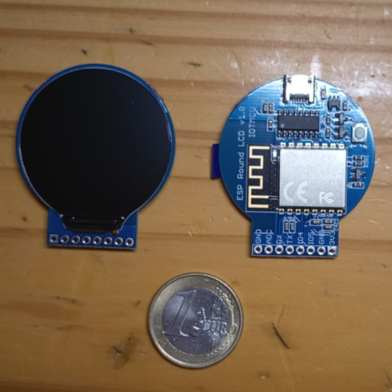
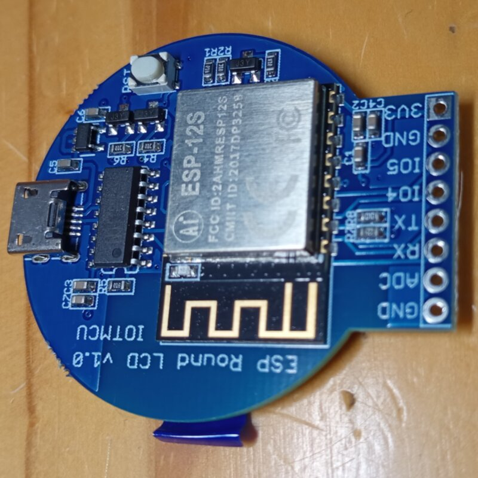
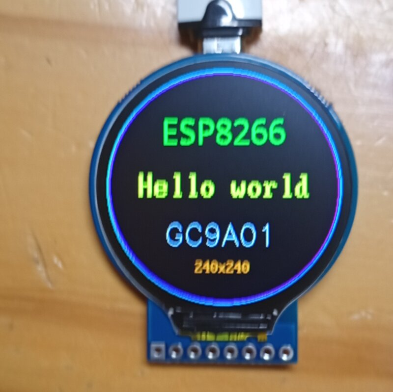
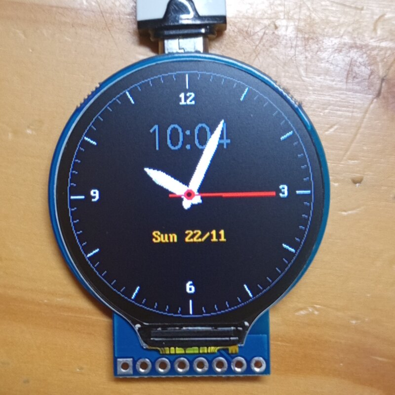
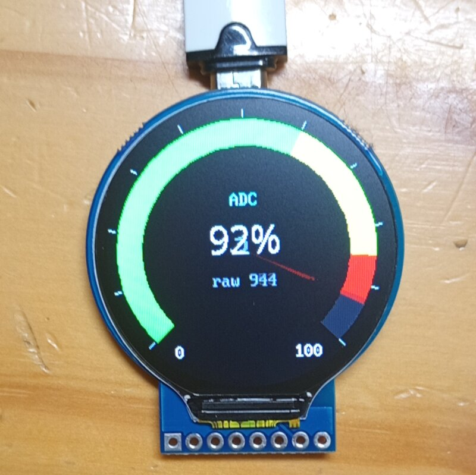

# MicroPython para ESP Round LCD (ESP8266 + GC9A01)

[English](README.md) | **Español**

Firmware MicroPython **v1.29.0** para la placa *ESP Round LCD v1.0* (IOTMCU):
ESP-12S (ESP8266EX, 4 MiB de flash) con pantalla IPS redonda de 1,28" y 240x240
(controlador GC9A01). El driver en C
[russhughes/gc9a01_mpy](https://github.com/russhughes/gc9a01_mpy) va integrado
en el firmware.

<p align="center">
  
  
</p>

## Estructura

| Ruta | Contenido |
|---|---|
| `micropython/` | MicroPython v1.29.0 (submódulo, upstream + `patches/`) |
| `patches/` | Parches sobre MicroPython que aplica `build.sh` |
| `gc9a01_mpy/` | Driver GC9A01 en C (submódulo, upstream, sin modificar) |
| `usermods/gc9a01` | symlink a `gc9a01_mpy/src`, es el módulo C de usuario |
| `boards/ESP_ROUND_LCD/` | Definición de la placa (basada en ESP8266_GENERIC) |
| `boards/ESP_ROUND_LCD/gen/` | Linker script generado por `build.sh` |
| `modules/round_lcd.py` | Helper congelado con los pines de la placa |
| `tools/xtensa-lx106-elf/` | Toolchain (mirror de micropython.org) |
| `tools/venv/` | Entorno Python con `mpremote` |
| `examples/` | Ejemplos |
| `img/` | Fotos del README |
| `build/firmware.bin` | Resultado |

## Preparación (una sola vez)

`micropython/` y `gc9a01_mpy/` son submódulos git fijados en las versiones
probadas; `tools/` se descarga:

```bash
git clone https://github.com/psicobyte/micropython-esp8266-gc9a01.git
cd micropython-esp8266-gc9a01
git submodule update --init --depth 1     # sin --recursive: eso baja los submódulos de todos los ports (~2 GB)
mkdir -p tools && curl -L https://micropython.org/resources/xtensa-lx106-elf-standalone.tar.gz \
    | tar xz -C tools && rm tools/xtensa-lx106-elf/bin/esptool.py
python3 -m venv tools/venv && tools/venv/bin/pip install mpremote esptool
```

`build.sh` compila `mpy-cross` y descarga los submódulos propios de MicroPython la primera vez.

## Compilar y flashear

```bash
./build.sh                 # -> build/firmware.bin
esptool --port /dev/ttyUSB0 erase_flash      # la primera vez (borra el FS)
./build.sh deploy          # PORT=/dev/ttyUSB0 BAUD=460800 FLASH_MODE=dio
tools/venv/bin/mpremote connect /dev/ttyUSB0 run examples/hello_world.py
```

## Uso

```python
import gc9a01, round_lcd
import vga1_bold_16x32 as font

tft = round_lcd.display()          # SPI(1) a 80 MHz, rotación 0
# round_lcd.display(cpu_freq=160_000_000)  # aún más rápido, algo más de consumo
tft.fill(gc9a01.BLACK)
tft.text(font, "Hola", 88, 104, gc9a01.YELLOW, gc9a01.BLACK)
```

Fuentes congeladas: `vga1_8x8`, `vga1_8x16`, `vga1_bold_16x32` (`text()`),
`romans` (Hershey, `draw()`), `NotoSans_32` (proporcional, `write()`). Las demás
de `gc9a01_mpy/modules` y `gc9a01_mpy/fonts` se pueden copiar al FS.

API completa: https://russhughes.github.io/gc9a01_mpy/

## Ejemplos

<p align="center">
  
  
  
</p>

| Fichero | Qué muestra |
|---|---|
| `examples/hello_world.py` | Las tres clases de fuente: `text()`, `write()`, `draw()`; `circle()` |
| `examples/clock.py` | Reloj analógico: `fill_polygon()` con rotación, `line()`, `fill_circle()`, NTP/RTC, CPU a 160 MHz |
| `examples/gauge.py` | Indicador con el pin ADC: `fill_arc()`, redibujado parcial sin parpadeo, `rotation=`. Modo demo si el ADC lee 0 |

```bash
tools/venv/bin/mpremote connect /dev/ttyUSB0 rtc --set + run examples/clock.py
tools/venv/bin/mpremote connect /dev/ttyUSB0 run examples/gauge.py
```

Para que un ejemplo arranque solo al encender: `mpremote cp examples/clock.py :main.py`.

El código de los ejemplos (identificadores, comentarios y textos) está en inglés.

## Pines de la placa

| GC9A01 | GPIO |
|---|---|
| SCK | 14 (HSPI) |
| MOSI | 13 (HSPI) |
| CS | 15 |
| DC | 2 |
| RST | 16 |
| Backlight | 12 (alto = encendido) |

En el conector quedan libres: ADC, RX, TX, GPIO4 y GPIO5.

## Rendimiento

`patches/0001-esp8266-spi-fifo-write.patch` (lo aplica `build.sh`): el SPI
hardware del port ESP8266 enviaba un byte por transacción; el parche usa la FIFO
de 64 bytes del HSPI. Afecta a toda escritura por `SPI(1)`, no solo a la pantalla.

| CPU / SPI | `fill()` original | `fill()` con parche | 140 caracteres 16x32 (orig → parche) |
|---|---|---|---|
| 80 / 40 MHz | 237 ms | 35 ms | 334 → 71 ms |
| 80 / 80 MHz | 237 ms | 28 ms | 334 → 64 ms |
| 160 / 40 MHz | 183 ms | 29 ms | 250 → 51 ms |
| 160 / 80 MHz | 152 ms | 18 ms | 209 → 36 ms |

El envío byte a byte viene de cómo se añadió el SPI hardware al port en 2016
([PR #2172](https://github.com/micropython/micropython/pull/2172), basado en una
librería sin soporte de FIFO); no hay ninguna decisión de diseño documentada que
lo justifique. El core de Arduino para ESP8266 usa la FIFO de la misma forma.

## Notas técnicas

- **Linker**: el port esp8266 solo coloca en flash (irom0) los objetos que lista
  en `esp8266_common.ld`; el resto va a IRAM (32 KiB) y el driver no cabe
  (desborda unos 21 KB). `build.sh` genera un linker script con el driver
  (`*/gc9a01/*.o`) en irom0, sin tocar el árbol de MicroPython.
- **RAM**: un framebuffer completo (115 KB) no cabe en el ESP8266. Usa
  `buffer_size=0` (buffer dinámico por operación) y las primitivas del driver.
  `jpg()` necesita al menos 3100 bytes de área de trabajo más el buffer; usa
  `gc9a01.SLOW` para imágenes grandes.
- El port ESP8266 es Tier 3 en MicroPython (mantenimiento mínimo).
- El enlace a la toolchain del README oficial (jepler/esp-open-sdk) ya no existe;
  se usa el mirror que usa el CI: `https://micropython.org/resources/xtensa-lx106-elf-standalone.tar.gz`.

## Licencia

MIT, ver [LICENSE](LICENSE). MicroPython y gc9a01_mpy (submódulos, e incluidos
en el firmware compilado) también son MIT, de sus respectivos autores.
