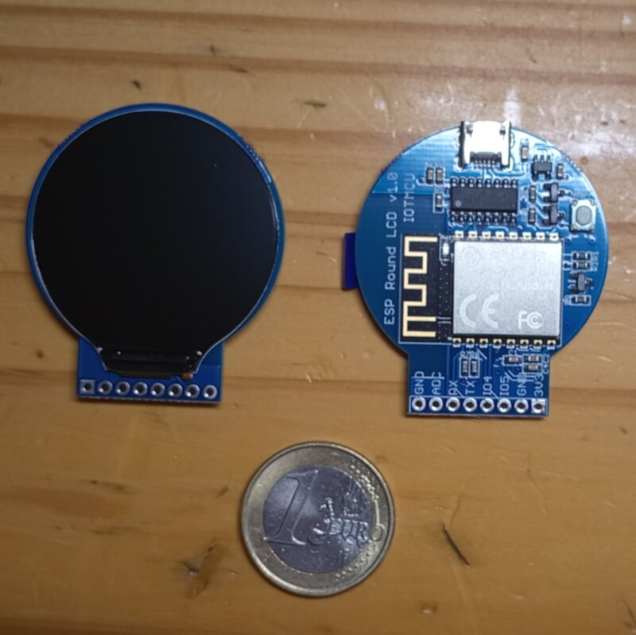
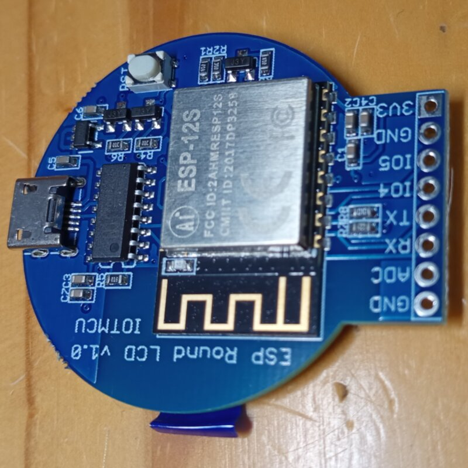
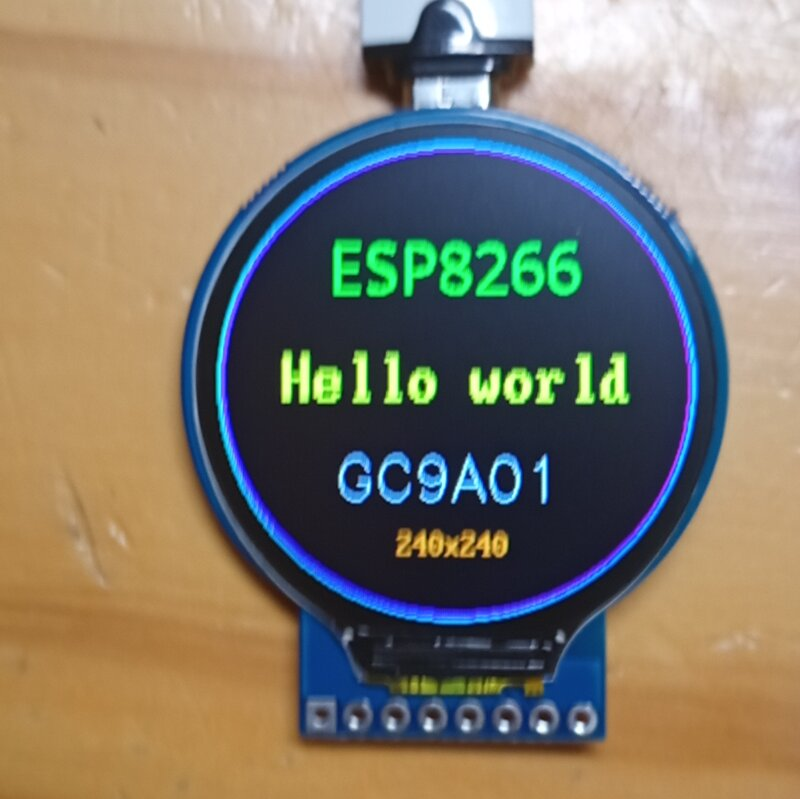
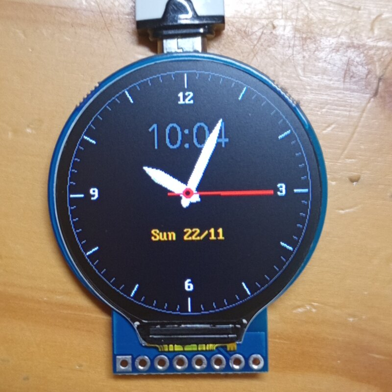
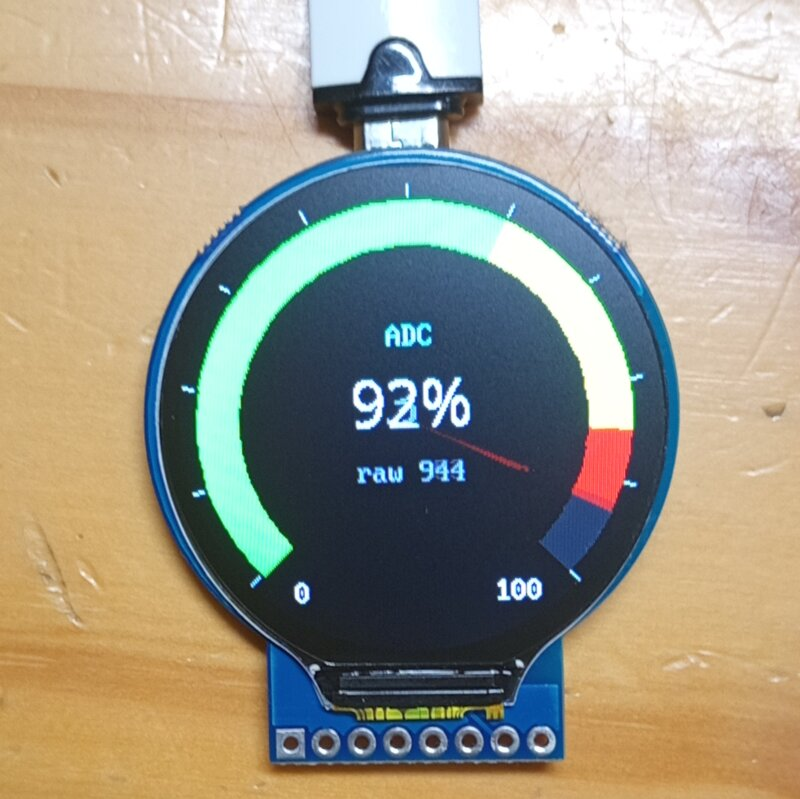

# MicroPython for ESP Round LCD (ESP8266 + GC9A01)

**English** | [Español](README.es.md)

MicroPython **v1.29.0** firmware for the *ESP Round LCD v1.0* board (IOTMCU):
an ESP-12S (ESP8266EX, 4 MiB flash) with a 1.28" 240x240 round IPS display
(GC9A01 controller). The C driver
[russhughes/gc9a01_mpy](https://github.com/russhughes/gc9a01_mpy) is built into
the firmware.

<p align="center">
  
  
</p>

## Layout

| Path | Contents |
|---|---|
| `micropython/` | MicroPython v1.29.0 (submodule, upstream + `patches/`) |
| `patches/` | Patches to MicroPython, applied by `build.sh` |
| `gc9a01_mpy/` | GC9A01 C driver (submodule, upstream, unmodified) |
| `usermods/gc9a01` | Symlink to `gc9a01_mpy/src`; the user C module |
| `boards/ESP_ROUND_LCD/` | Board definition (based on ESP8266_GENERIC) |
| `boards/ESP_ROUND_LCD/gen/` | Linker script generated by `build.sh` |
| `modules/round_lcd.py` | Frozen helper with the board's pinout |
| `tools/xtensa-lx106-elf/` | Toolchain (micropython.org mirror) |
| `tools/venv/` | Python environment with `mpremote` |
| `examples/` | Examples |
| `img/` | README photos |
| `build/firmware.bin` | Output |

## Setup (once)

`micropython/` and `gc9a01_mpy/` are git submodules pinned to the tested
versions; `tools/` is downloaded:

```bash
git clone https://github.com/psicobyte/micropython-esp8266-gc9a01.git
cd micropython-esp8266-gc9a01
git submodule update --init --depth 1     # not --recursive: that pulls every port's submodules (~2 GB)
mkdir -p tools && curl -L https://micropython.org/resources/xtensa-lx106-elf-standalone.tar.gz \
    | tar xz -C tools && rm tools/xtensa-lx106-elf/bin/esptool.py
python3 -m venv tools/venv && tools/venv/bin/pip install mpremote esptool
```

`build.sh` builds `mpy-cross` and fetches MicroPython's own submodules on first run.

## Build and flash

```bash
./build.sh                 # -> build/firmware.bin
esptool --port /dev/ttyUSB0 erase_flash      # first time only (wipes the filesystem)
./build.sh deploy          # PORT=/dev/ttyUSB0 BAUD=460800 FLASH_MODE=dio
tools/venv/bin/mpremote connect /dev/ttyUSB0 run examples/hello_world.py
```

## Usage

```python
import gc9a01, round_lcd
import vga1_bold_16x32 as font

tft = round_lcd.display()          # SPI(1) at 80 MHz, rotation 0
# round_lcd.display(cpu_freq=160_000_000)  # even faster, slightly higher power draw
tft.fill(gc9a01.BLACK)
tft.text(font, "Hello", 80, 104, gc9a01.YELLOW, gc9a01.BLACK)
```

Frozen fonts: `vga1_8x8`, `vga1_8x16`, `vga1_bold_16x32` (`text()`),
`romans` (Hershey, `draw()`), `NotoSans_32` (proportional, `write()`). The rest
of `gc9a01_mpy/modules` and `gc9a01_mpy/fonts` can be copied to the filesystem.

Full API: https://russhughes.github.io/gc9a01_mpy/

## Examples

<p align="center">
  
  
  
</p>

| File | What it shows |
|---|---|
| `examples/hello_world.py` | The three font types: `text()`, `write()`, `draw()`; `circle()` |
| `examples/clock.py` | Analog clock: rotated `fill_polygon()`, `line()`, `fill_circle()`, NTP/RTC, CPU at 160 MHz |
| `examples/gauge.py` | Gauge driven by the ADC pin: `fill_arc()`, flicker-free partial redraw, `rotation=`. Demo mode if the ADC reads 0 |

```bash
tools/venv/bin/mpremote connect /dev/ttyUSB0 rtc --set + run examples/clock.py
tools/venv/bin/mpremote connect /dev/ttyUSB0 run examples/gauge.py
```

To run an example at power-up: `mpremote cp examples/clock.py :main.py`.

## Board pinout

| GC9A01 | GPIO |
|---|---|
| SCK | 14 (HSPI) |
| MOSI | 13 (HSPI) |
| CS | 15 |
| DC | 2 |
| RST | 16 |
| Backlight | 12 (high = on) |

Free pins on the header: ADC, RX, TX, GPIO4 and GPIO5.

## Performance

`patches/0001-esp8266-spi-fifo-write.patch` (applied by `build.sh`): the ESP8266
port's hardware SPI sent one byte per transaction; the patch uses the HSPI's
64-byte FIFO instead. It speeds up every `SPI(1)` write, not just the display.

| CPU / SPI | `fill()` original | `fill()` patched | 140 chars 16x32 (orig → patched) |
|---|---|---|---|
| 80 / 40 MHz | 237 ms | 35 ms | 334 → 71 ms |
| 80 / 80 MHz | 237 ms | 28 ms | 334 → 64 ms |
| 160 / 40 MHz | 183 ms | 29 ms | 250 → 51 ms |
| 160 / 80 MHz | 152 ms | 18 ms | 209 → 36 ms |

The byte-at-a-time transfer dates back to when hardware SPI was added to the
port in 2016 ([PR #2172](https://github.com/micropython/micropython/pull/2172),
based on a library with no FIFO support); there is no documented design reason
for it. The ESP8266 Arduino core uses the FIFO the same way.

## Technical notes

- **Linker**: the esp8266 port only places in flash (irom0) the objects listed
  in `esp8266_common.ld`; everything else goes to IRAM (32 KiB), where the
  driver doesn't fit (about 21 KB over). `build.sh` generates a linker script
  that puts the driver (`*/gc9a01/*.o`) in irom0, without touching the
  MicroPython tree.
- **RAM**: a full framebuffer (115 KB) doesn't fit in the ESP8266. Use
  `buffer_size=0` (per-operation dynamic buffer) and the driver's primitives.
  `jpg()` needs at least 3100 bytes of work area plus the buffer; use
  `gc9a01.SLOW` for large images.
- The ESP8266 port is Tier 3 in MicroPython (minimal maintenance).
- The toolchain link in the official README (jepler/esp-open-sdk) no longer
  exists; this project uses the mirror MicroPython's CI uses:
  `https://micropython.org/resources/xtensa-lx106-elf-standalone.tar.gz`.

## License

MIT, see [LICENSE](LICENSE). MicroPython and gc9a01_mpy (submodules, and part
of the compiled firmware) are also MIT-licensed, by their respective authors.
